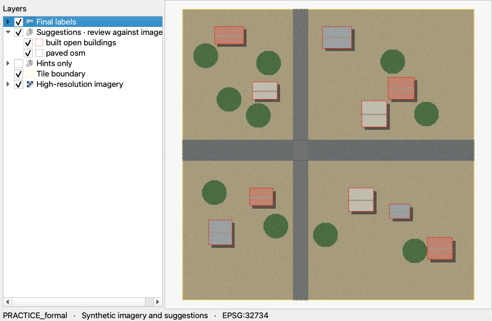
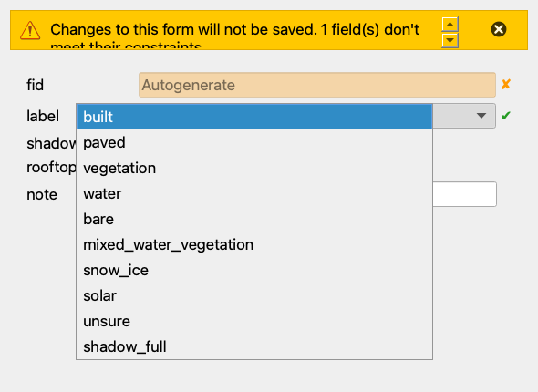

# Faster Item 21 labelling in QGIS

**All six remaining Stage 1 training tiles and both unscored practice tiles are ready on this Mac.** Each tile now has a separate suggestion package and a QGIS project that opens on the correct image. All original 62 files inventoried in the Stage 1 and practice tile folders matched their original SHA256 after installation. The two already-labelled Cape Town Stage 1 tiles received no new files. The time saving awaits Kanveer's first complete timed trace.

## Start in three steps

1. **Enable the plugin.** The GeoWatch plugin is linked into the default QGIS profile on this Mac. Start or restart QGIS LTR when convenient, then open **Plugins → Manage and Install Plugins → Installed** and enable **GeoWatch Item 21 review**. If QGIS is already open with unsaved work, save it first. [Other profiles and installation instructions](tools/labelling/PLUGIN.md)
2. **Open a practice project.** In QGIS choose **Project → Open**, browse to the live GeoWatch folder, and open `data/practice_tiles/PRACTICE_formal/label_project.qgz`. If needed choose **Plugins → GeoWatch → GeoWatch · Item 21** to show the panel. The high-resolution image is under **Suggestions** and **Final labels** in the Layers list.
3. **Review the first shape.** Click the map and press **]** to zoom to an unchecked suggestion. Compare it with the photograph. Press **A** to keep it, **E** to adjust it, or **R** to reject it. Use **D** for surfaces the suggestions missed. Save layer edits regularly. For the timed trial, open the formal Karachi project and press **T** before tracing. [Timing form](tools/labelling/TIMING.md)

## Ready tiles

Within the live checkout, the Stage 1 path is `data/stage1/tiles/<city>/<tile ID>/label_project.qgz`. Practice uses `data/practice_tiles/<tile ID>/label_project.qgz`. The companion `prelabels.gpkg` lives in the same directory. The counts are review workload before human decisions.

| City or purpose | Tile ID | Reviewable polygons | Display-only hints |
|---|---|---:|---:|
| Karachi · formal | EPSG32642_297600_2761800 | 339 | 83 |
| Karachi · dense informal | EPSG32642_297800_2761000 | 377 | 99 |
| Lima · mixed | EPSG32718_290000_8659000 | 269 | 15 |
| Lima · fringe | EPSG32718_290600_8659200 | 9 | 0 |
| Monrovia · formal | EPSG32629_300800_699600 | 254 | 167 |
| Monrovia · dense informal | EPSG32629_301000_699800 | 378 | 156 |
| Cape Town · practice dense informal | PRACTICE_dense_informal | 494 | 130 |
| Cape Town · practice formal | PRACTICE_formal | 582 | 64 |

The six training tiles provide **1,626 reviewable polygons and 520 display-only hints**. Google and OSM returned records for every target. The Microsoft mirror returned no footprints in the two Karachi queries. None of the eight tile packages contained an OSM water polygon. All eight images have RGB bands. Smooth blue-green patches and dark patches are hints that require visual interpretation. Unmapped water, concrete, bare ground and other missed surfaces still need to be traced. [Generation, widths, sources and attribution](tools/labelling/CANDIDATES.md)

## Keyboard reference

| Key | Action |
|---|---|
| **]** / **[** | Next / previous unchecked suggestion |
| **A** / **E** / **R** | Keep, copy for editing, or reject the displayed suggestion |
| **1–5** | Built, paved, bare, vegetation, water |
| **6–0** | Mixed water/vegetation, snow/ice, solar, full shadow, unsure |
| **D** / **F** | Draw a polygon / open the selected final polygon's form |
| **U** | Toggle the uncovered-area overlay. Refresh it after edits. |
| **T** | Start or stop timing. Only an explicit press writes the timing record. |
| **Mark tile done** | Save pending edits on confirmation, run final checks, and view the detailed report |

## What protects the labels

- **Ground truth still depends on a human decision.** Opening a project adds zero polygons to the final layer. Accepted geometry gets `prelabel_kept`. Changing its class or geometry makes it `prelabel_edited`. The **D** drawing tool records `hand_drawn`. The review retains source, object ID, version and candidate ID. A visual hint cannot be accepted. Imported legacy polygons with missing provenance must be reviewed.
- **Insist on the surface in the photo.** Compacted earth is bare, even under a mapped road. For Karachi, use the recorded wall-ground/base convention for off-nadir buildings. For identifiable shade, choose the surface and select the partial-shadow flag. Use full shadow only when the surface is unidentifiable. Use unsure for genuine ambiguity.
- **Finish the whole square.** Inspect the uncovered overlay and fix gaps, overlaps, invalid polygons and source mismatches. Mark tile done calls Phase A's rules for class flags, 1 m coverage, 10 m fractions and metadata. It can resolve saved sun lines on a private snapshot. Under the guide, Lima and Monrovia need at least three building shadow measurements when publisher acquisition times are unavailable. The validator can report the derived fractions and sun values without overwriting the source files. The first validation prompts for the existing GeoWatch Python executable, normally `geowatch-env/bin/python` in the live checkout.
- **Watch source dependence.** The report shows per-class and whole-tile provenance by both count and area. A warning appears when more than half of built polygons or built area was copied unchanged. Half marks a majority. Even below half, a copied or edited footprint shares a source with footprint-derived built. Use the independently hand-traced validation tiles to evaluate footprint accuracy.
- **Validation and blind repeats start from scratch.** The tools check site/city names, tile IDs, sealed path rules, the positive training/practice register, and the raster's actual footprint. Makoko, Kibera, Rocinha and their host cities are excluded. For the §7 blind repeat, use a clean imagery-only scratch project, wait at least one week for the same labeller, and keep the original labels hidden.
- **Version differences matter.** The Phase A branch enforces guide v1.6, including mixed water/vegetation, snow/ice and a rooftop-solar flag on built. The production taxonomy on master later dropped the mixed fraction and restricted solar to utility-scale. The tools preserve the Phase A labels and guide version. [Decision log](DECISIONS.md)

## QGIS setup

The screenshots show native QGIS 3.44 LTR widgets on synthetic imagery. The live projects open their own dated high-resolution photographs.

## Verification and speed measurement

**105 labelling, project and Stage 1 regression tests passed.** The eight projects were reopened under QGIS 3.44.14 after relocation. All 100 layer sources resolved. The edit lifecycle was tested on a temporary copy of the real practice image, including acceptance, manual drawing, native geometry changes, rejection, save/reopen and rollback. The existing ground-truth files and large generated suggestions are outside the branch's changes. [Software and test sources](tools/labelling/)

The formal Cape Town baseline recorded **approximately 60 minutes for 184 polygons**, including a restart. The other completed tile has 278 polygons and no recorded duration. The timing protocol leaves assisted minutes and speed-up blank for Kanveer to measure. [Timing protocol and result fields](tools/labelling/TIMING.md)
