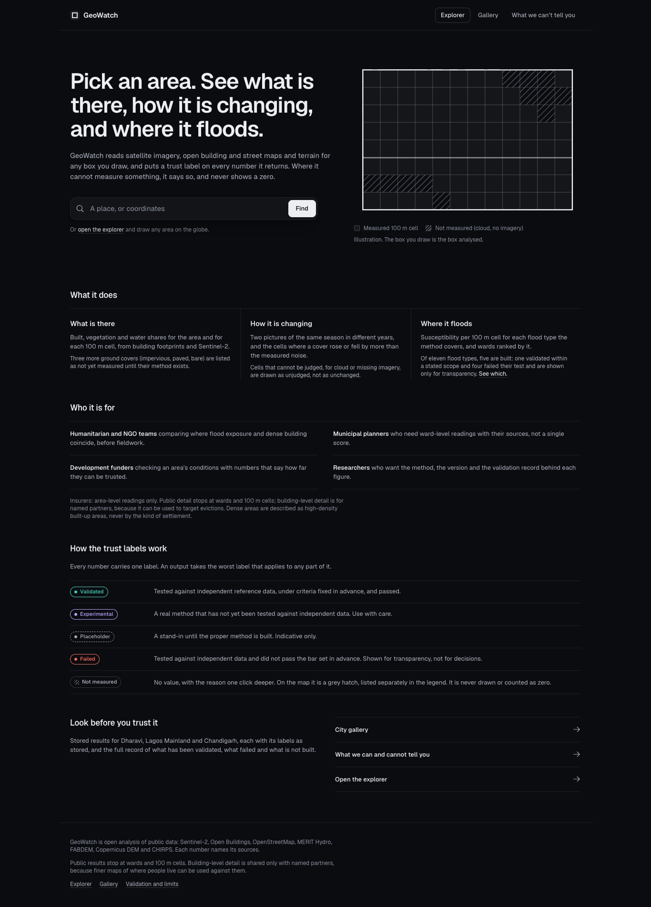
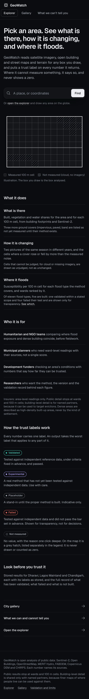
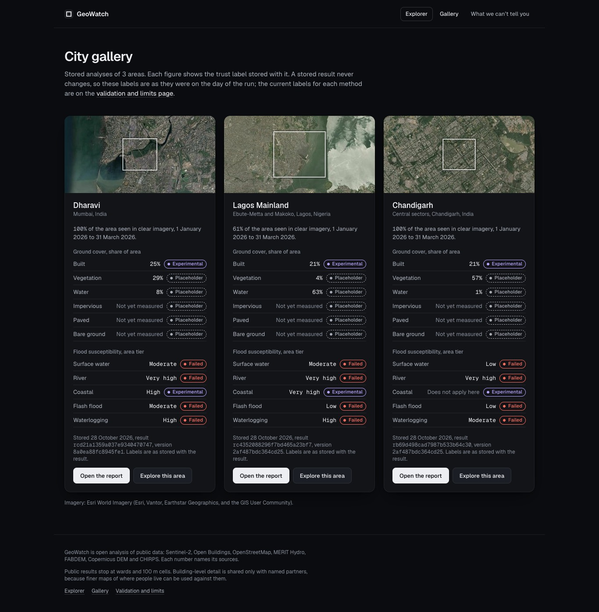
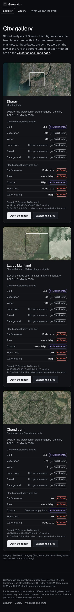
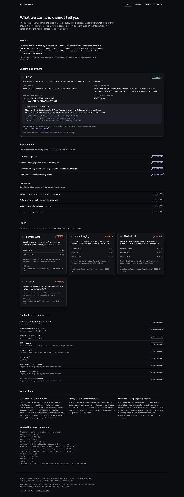
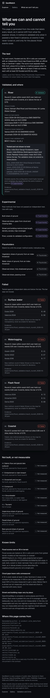
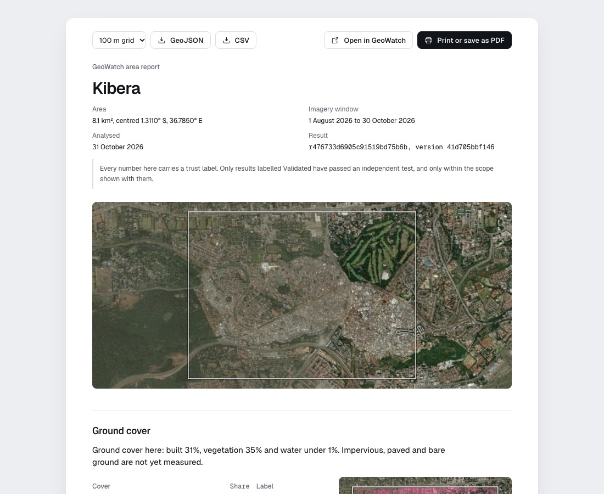

# Product track report (build/product)

Branch `build/product` off master 87f52cb, worktree `~/gw-product`. Merges
**last**, after the flood and change branches (MERGE_NOTES.md). Nothing was
deployed, no account was created, nothing was bought, nothing was merged.
Decisions taken along the way: DECISIONS.md (D1–D16).

## What is built

| Phase | Built | Checked |
|---|---|---|
| 1 Landing | `/`: what GeoWatch does, who it is for, how trust labels work, a place search that opens the explorer on the place, links to gallery and honesty page. Old `/?bbox=` and `?report=` links still work; `/explore` is the explorer | Lighthouse (mobile): performance 100, accessibility 100, best practices 100. axe: 0 violations, desktop and 390 px. No horizontal scroll |
| 2 Gallery | `/gallery`: Dharavi, Lagos Mainland, Chandigarh, each with ground cover and flood tiers, every value with its trust label, observed share, date, result id and version. Adding a city = one entry in `product/gallery_cities.json` | Lighthouse 100 / 100; axe 0. Values pinned to the run record by `tests/test_site_data.py` |
| 3 Honesty | `/honesty`: the test and its bar; validated (river/fluvial, with regions, events, tuning events, inputs, and where it was tested and failed); experimental; placeholders; failed (with per-event AUCs); not built (all 11 flood types); known limits (30 m cells, cloud gaps, OSM coverage regimes); provenance | Generated from `analysis/contract.py` by `python -m product.site_data`, cross-checked against `flood_verdicts()`. **`tests/test_site_data.py` fails when page and contract disagree**; `tests/test_web_site.mjs` fails if a page types its own decimal or percentage |
| 4 Downloads | Report page: GeoJSON and CSV for wards or the 100 m grid. Every value carries status, validation label, scope note, coverage, sources, result id, model version, code commit and licence notes; absent is null with its reason, never 0. No footprint/path units, no rasters | 7 node tests; end to end on stored result r476733… (850 grid units) through the local API and Chrome |
| 5 Deploy config | `deploy/asgi.py` gateway (health, CORS, rate limits, public explorer routes, building-level units key-only, JSON logs), `deploy/runtime.py` (EE service-account key file, code-commit guard), `deploy/worker.py` (SFINCS worker stub + file queue), Dockerfiles, nginx, `docker-compose.yml`, `render.yaml`, `.env.example`, **DEPLOY.md** | 38 tests; gateway run live under uvicorn; compose validated; requirements resolve to Linux wheels; 142 serving tests pass with torch/geemap blocked. **Image not built**: an SFINCS container was running (D15) |
| 6 Density (item 23) | Diagnosed; segmentation-robust built-mass metrics; v2 test pre-registered (c29ab06, pushed before scoring) and run | **Still FAIL** (v2: 2 hold, 1 reversed). Details below |

Test suite on the final commit: pytest 1076 passed, 4 skipped (master
baseline 1023 + 53 new); node web tests 8 + 42 + 10 + 7 passed.

## Screenshots

Landing, desktop and phone:

Gallery:

Honesty page:

Report with the download bar:

## Things you should know

1. **The gallery's report links do not resolve yet.** The three result IDs
   in the 28 Oct run record are not in any store on this Mac (they were
   computed at an older version). The cards show the stored values and
   labels correctly; "Open the report" shows "could not be loaded" until
   the cities are re-run where the site is served (DEPLOY.md §7). Those
   labels also predate flood round 2 (river shows `failed` there); the page
   says labels are as stored and links to the honesty page.
2. **The API had no rate limits.** The brief said they existed; only the
   2-run job pool and the 100 km² cap did. The gateway adds them (D11).
3. **Building-level units were public.** `GET /api/results/<id>/wards/footprint`
   (and `path`) are public reads in api.py today. The gateway closes them
   for the deployment without editing api.py (D9). The explorer never used
   them.
4. **A public explorer needs the server to hold the key.** The gateway
   forwards the explorer's few protected routes with the server key, behind
   caps (4 analyses/hour/client, 100/day overall). `GEOWATCH_PUBLIC_JOBS=0`
   turns public analysis off (D12).
5. **Licences:** FABDEM and MERIT Hydro are non-commercial, so every flood
   output is too. Downloads say so; GeoWatch's own licence is not chosen
   (D8, DEPLOY.md §0).
6. **Esri imagery terms** still need checking before going public
   (DESIGN.md already said so; DEPLOY.md §0).
7. **Item 23.** The v1 test failed because on Open Buildings ~73% of
   polygons touch another one in *both* places: Chandigarh's houses are cut
   into rooftop fragments, Dharavi's dwellings share walls. Per-polygon
   metrics measure segmentation. New built-mass metrics are immune to that,
   and contiguity separated the two AOIs 13×. But v2 failed: built share
   1.19× (bar 1.5×), gaps between masses reversed. v2 was designed after
   seeing these AOIs, so even its holding predictions are not evidence.
   Bars not moved, no further variants, label stays `experimental`. The
   next step needs a held-out pair chosen with local knowledge
   (`experiments/density_fix/REPORT.md`).
8. **Merge effects** (MERGE_NOTES.md): the `vector/density.py` change moves
   `code_commit`, so results computed after the merge get new IDs (no
   output value changes: the pipeline does not call it). After the flood
   branch merges, run `python -m product.site_data` and commit: the
   site-data test fails until you do, by design.
9. The explorer (`/explore`, unchanged) has two pre-existing axe findings;
   left for after the flood/change merges to avoid conflicts (D6).

## Files

- Status: `STATUS.md` · decisions: `DECISIONS.md` · merge notes:
  `MERGE_NOTES.md` · deploy guide: `DEPLOY.md`
- Site: `web/src/site/`, `web/src/lib/{route,honesty,gallery,tiles,download}.js`,
  `web/src/report/DownloadBar.jsx`, `web/src/styles/site.css`,
  generated data `web/src/generated/`, generator `product/site_data.py`
- Deploy: `deploy/`, `docker-compose.yml`, `render.yaml`, `.env.example`,
  `.dockerignore`
- Density: `vector/density.py`, `experiments/density_fix/`
