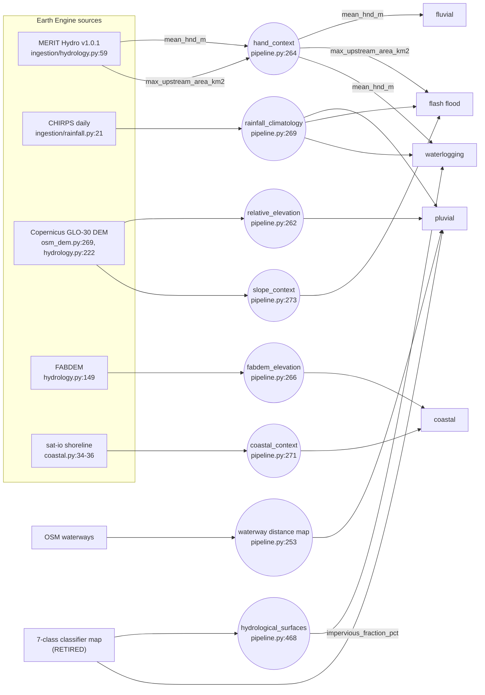

# Susceptibility dependency DAG and cross-AOI correlation (item 66)

**The misreading this defuses:** "four of five layers agree, therefore the
evidence converges." The five layers are not independent measurements. They
read a few shared inputs through fixed, provisional formulas. When they
agree, that is partly the formulas agreeing with themselves.

Scope: the five modules in `susceptibility/` (pluvial, fluvial, coastal,
flash flood, waterlogging) as wired in `pipeline.py`. `event_hazard.py`
conditions some of them on event forcing and is not a sixth layer
(`05_BUILD_MANUAL.md`, validation-first mandate). The pluvial and waterlogging
layers consume the retired 7-class classifier's output (`08_STATE.md`
§RETIRED). This document describes the wiring as it stands. It is not an
endorsement of that input.

Under the validation-first mandate (2026-09-24), none of these layers is
validated. All weights and ceilings are marked PROVISIONAL in their own
config files.

## 1. The DAG

Every edge was read from code. Citations are `file:line` at commit `e07b4de`.



### Shared inputs (counted from the edges above)

| input | layers that read it | which field |
|---|---|---|
| **MERIT Hydro** (`hand_context`) | **fluvial, flash flood, waterlogging (3)** | `mean_hnd_m` (fluvial, waterlogging); `max_upstream_area_km2` (flash flood) |
| **CHIRPS** (`rainfall_climatology`) | **pluvial, flash flood, waterlogging (3)** | `mean_annual_mm` |
| classifier map (retired) | pluvial, waterlogging (2) | per-pixel class weights (pluvial); area-% class weights via `hydrological_surfaces` (waterlogging), both from `configs/applicability_constants.py:33,41` |
| Copernicus GLO-30 | pluvial, flash flood (2) | AOI-relative elevation (pluvial); mean slope (flash flood) |
| FABDEM, shoreline, OSM waterways | one layer each | — |

**Two inputs are each read by three of the five layers:** MERIT Hydro and
CHIRPS. Waterlogging reads both, plus the classifier. Only coastal shares
nothing with the other four. **Fluvial is a single-input layer.** Its score
is `1 − mean_hnd_m / 30`, clamped (`susceptibility/fluvial.py:46`). So it is
a linear relabelling of one MERIT statistic, and waterlogging re-reads that
same statistic.

### Normalisation ceilings

Each component is divided by a fixed ceiling and clamped to [0, 1]:

| layer | component | ceiling | defined at |
|---|---|---|---|
| pluvial | rainfall | 200–4,500 mm/yr range | `configs/pluvial_constants.py:8,20` |
| pluvial | drainage distance | **AOI max** (`dist / dist.max()`) | `ingestion/osm_dem.py` (`compute_waterway_distance_map`, final line) |
| pluvial | relative elevation | **AOI p10–p90** | `ingestion/osm_dem.py` (`hand_proxy`, p10/p90 percentiles) |
| fluvial | HAND | 30 m | `configs/fluvial_constants.py:30` |
| coastal | distance to coast | 15 km | `configs/coastal_constants.py:33` |
| coastal | elevation | 10 m | `configs/coastal_constants.py:43` |
| flash flood | slope | 15° | `configs/flash_flood_constants.py:11` |
| flash flood | upstream area | 50 km² | `configs/flash_flood_constants.py:19` |
| flash flood | rainfall | **2,500 mm** | `configs/flash_flood_constants.py:26` |
| waterlogging | HAND | 15 m | `configs/waterlogging_constants.py:15` |
| waterlogging | impervious | 70 % | `configs/waterlogging_constants.py:20` |
| waterlogging | rainfall | **2,500 mm** | `configs/waterlogging_constants.py:33` |

Three things follow from the table:

- **The 2,500 mm rainfall ceiling appears twice as two separate definitions**
  with the same name and value: `flash_flood_constants.py:26` and
  `waterlogging_constants.py:33`. Waterlogging imports its own copy
  (`susceptibility/waterlogging.py:18-22`). The two layers therefore share a
  value, not a definition, and could drift apart silently.
- **HAND is normalised two different ways** for the same statistic: 30 m
  (fluvial) and 15 m (waterlogging).
- **Two pluvial components are AOI-relative** (max-normalised distance,
  p10–p90 elevation). Those components cannot be compared across AOIs.

*The build-manual text for this item says "three provisional ceilings". This
reading counts ten fixed ceiling definitions (the pluvial rainfall range
counted as one), two of which are the duplicated 2,500 mm rainfall ceiling,
plus two AOI-relative normalisations. The difference is a counting convention, recorded here so
that neither count is quoted without the other.*

### Class breaks

All five layers, and `event_hazard.py`, bin scores with **identical** breaks:
very_low [0, 0.2), low [0.2, 0.4), moderate [0.4, 0.6), high [0.6, 0.8),
very_high [0.8, 1.01). The six `*_CLASS_BREAKS` dict bodies in
`configs/{pluvial,fluvial,coastal,flash_flood,waterlogging,event_hazard}_constants.py`
hash identically (sha256 prefix `7b26555d4f0d2e67`, operation below). So
"same class" across layers means "same fifth of an arbitrary [0, 1] scale",
not equal hazard.

## 2. Cross-AOI correlation

**Input.** Every `data/pipeline_runs/*/result.json` (137 files). 99 have no
`susceptibility` block, from older schema runs. The remaining 38 cover **11
distinct AOI bounding boxes**, deduplicated at 1e-3°, keeping the latest run
per box. Read 2026-10-28.

**Read this caveat before the numbers.** The 11 AOIs are not a sample.
Five are overlapping Mumbai boxes, two are Delhi, two are Accra, and two are
single AOIs elsewhere in India. The runs also span code versions from
2026-07-28 to 2026-08-31. One example: Delhi scores coastal 0.0 with status
`experimental` in one run (212.7 km from coast) and `not_applicable` in
another. With n = 7–9 and that clustering, the matrices below are
**descriptive of this run set only**. They are not an estimate of how the
layers co-vary in general.

| run id | pluvial | fluvial | coastal | flash flood | waterlogging |
|---|---:|---:|---:|---:|---:|
| `accra_phase7_check_20260731_123428` | 0.4193 | 0.6393 | 0.7844 | 0.1506 | 0.3299 |
| `aoi_20260806_125219` | 0.6862 | 0.8819 | 0.0 | 0.0834 | 0.7411 |
| `aoi_20260831_142458` | 0.373 | 0.624 | n/a | 0.2937 | 0.3663 |
| `delhi_phase10a_final_20260801_131628` | 0.5535 | 0.8735 | n/a | 0.2055 | 0.6738 |
| `oqvalidate_dharavi_20260821_154627` | 0.5868 | 0.8866 | 0.757 | 0.4089 | 0.7895 |
| `phase12b_wide_datameet_mumbai_bmc_wards_20260822_014426` | 0.5376 | 0.4118 | 0.5 | 0.4163 | 0.4565 |
| `phase1_multitile_20260820_130117` | 0.6489 | 0.8469 | 0.777 | 0.3942 | 0.7671 |
| `phase6_accra_coastal_check_20260728_154557` | 0.5537 | 0.6785 | 0.5 | — | — |
| `phase6_delhi_recheck_20260730_161429` | 0.5906 | 0.909 | 0.0 | — | — |
| `pilot_3ward_20260807_162911` | 0.6642 | 0.7639 | 0.7913 | 0.5914 | 0.6894 |
| `ward_pilot_timing_20260809_113812` | 0.6561 | 0.775 | 0.8477 | 0.6802 | 0.6532 |

(n/a = `not_applicable`; — = `not_calculated`, from runs before the layer existed.)

**Pearson r, four non-coastal layers, n = 9:**

| | pluvial | fluvial | flash flood | waterlogging |
|---|---:|---:|---:|---:|
| pluvial | 1 | 0.557 | 0.376 | **0.868** |
| fluvial | | 1 | −0.087 | **0.804** |
| flash flood | | | 1 | 0.239 |
| waterlogging | | | | 1 |

**Pearson r, all five layers, n = 7:**

| | pluvial | fluvial | coastal | flash flood | waterlogging |
|---|---:|---:|---:|---:|---:|
| pluvial | 1 | 0.599 | −0.268 | 0.363 | **0.855** |
| fluvial | | 1 | −0.054 | −0.045 | **0.810** |
| coastal | | | 1 | 0.645 | −0.123 |
| flash flood | | | | 1 | 0.248 |
| waterlogging | | | | | 1 |

Spearman ρ for the n = 9 set, as a rank check: pluvial–waterlogging 0.667,
fluvial–waterlogging 0.817, fluvial–flash flood −0.233.

**Layers against their own shared inputs (n = 8, Pearson):**
fluvial vs `mean_hnd_m` **−1.000**, which holds **by construction** (fluvial is
linear in HAND), not as a finding. Waterlogging vs `mean_hnd_m` −0.785.
Flash flood vs CHIRPS mm 0.742. Waterlogging vs impervious % 0.705.

**What the matrices show.** The strongest pairs are waterlogging with
pluvial and waterlogging with fluvial. Those are exactly the pairs that share
inputs: waterlogging reads MERIT HAND like fluvial, and reads CHIRPS plus the
classifier like pluvial. Flash flood also reads MERIT, but a different field
(upstream area, with the opposite sign), and it barely correlates with
fluvial. **The pattern of agreement follows the pattern of shared inputs.**

**"Four of five agree", counted.** Over the 7 AOIs where all five layers
carry a class, the largest same-class group has size 5 in 1 AOI, 4 in 2,
3 in 1, and 2 in 3. Even where four layers agree, the DAG says that
agreement draws on at most four independent sources (MERIT, CHIRPS,
classifier, GLO-30). Coastal is the only layer with sources of its own.

## Reproduce

```python
# class-break identity
import re, hashlib
for f in ["pluvial","fluvial","coastal","flash_flood","waterlogging","event_hazard"]:
    s = open(f"configs/{f}_constants.py").read()
    body = re.search(r"_CLASS_BREAKS = \{\n(.*?\n\})", s, re.S).group(1)
    print(f, hashlib.sha256((body + "\n").encode()).hexdigest()[:16])

# correlation (run from the repo root)
import glob, json, os, numpy as np
L = ["pluvial", "fluvial", "coastal", "flash_flood", "waterlogging"]; rows = {}
for f in sorted(glob.glob("data/pipeline_runs/*/result.json")):
    r = json.load(open(f)); s = r.get("susceptibility")
    if not isinstance(s, dict): continue
    k = tuple(round(r["aoi"][c], 3) for c in ("west", "south", "east", "north"))
    rid = os.path.basename(os.path.dirname(f))
    if k not in rows or rid[-15:] > rows[k][0][-15:]:
        rows[k] = (rid, [(s.get(x) or {}).get("aoi_mean_score") for x in L])
four = [[v[i] for i in (0, 1, 3, 4)] for _, v in rows.values() if None not in (v[0], v[1], v[3], v[4])]
print(len(rows), len(four)); print(np.round(np.corrcoef(np.array(four).T), 3))
```
